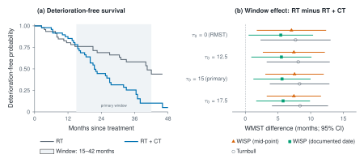
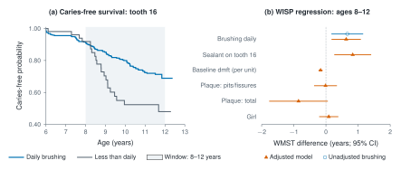

# WISP

**Window Mean Survival Time Regression for Interval-Censored Data Using Pseudo-Observations**

WISP estimates covariate associations in units of time within a specified follow-up window. It combines event-time reconstruction, Kaplan–Meier estimation, infinitesimal jackknife pseudo-observations and identity-link regression. An additional complete-response IPCW estimator handles baseline-dependent monotone dropout under a common assessment grid.

Authors: Hao Chen and Clara Grazian, School of Mathematics and Statistics, The University of Sydney. Maintainer: Hao Chen, hche2036@uni.sydney.edu.au.

## Installation

Install the development version from GitHub:

```r
install.packages("remotes")
remotes::install_github("haohaostats/WISP")
```

Alternatively, build a source package from a local checkout. In a terminal, with R available:

```sh
R CMD build WISP
R CMD INSTALL WISP_0.1.0.tar.gz
```

Or in R, with the source archive in the working directory:

```r
install.packages("survival")
install.packages("WISP_0.1.0.tar.gz", repos = NULL, type = "source")
library(WISP)
```

## Results at a glance

### Breast cosmetic deterioration

**94 women · 15–42 months · RT minus RT + chemotherapy**



The midpoint WISP estimate was **7.53 additional months** without moderate or severe breast retraction in the RT group within the primary window.

| Analysis | WMST difference (months) | 95% CI |
|---|---:|---:|
| **WISP: midpoint** | **7.53** | **3.06 to 12.00** |
| Documented date | 5.62 | 1.24 to 9.99 |
| Turnbull comparison | 8.31 | 3.75 to 12.87 |

Pseudo-observations were constructed within treatment groups. WISP intervals use HC0 standard errors; the Turnbull comparison uses bootstrap standard errors. The figure also shows the alternative windows. These are observed group contrasts in a retrospective study.

### Dental caries development

**369 children · ages 8–12 years · permanent tooth 16**



After covariate adjustment, daily brushing was associated with **0.630 additional caries-free years**, approximately **7.6 months**, within the analysis window.

| Daily-brushing analysis | WMST difference (years) | 95% CI | SE |
|---|---:|---:|---:|
| Midpoint, unadjusted | 0.665 | 0.170 to 1.159 | 0.252 |
| **Midpoint, adjusted** | **0.630** | **0.174 to 1.087** | **0.233** |
| Documented date, adjusted | 0.525 | 0.106 to 0.943 | 0.214 |

The adjusted model includes baseline dmft, occlusal plaque, sealant status and sex. Both models use the same complete-case sample. Curves are descriptive and unadjusted; forest-plot coefficients are adjusted associations with 95% HC0 intervals.

## A first analysis

```r
library(WISP)
left <- c(0, 1, 1, 2, 2, 3, 4, 4)
right <- left + 1
Z <- data.frame(treatment = rep(c(0, 1), 4))
fit <- wisp(left, right, Z, tau0 = 1, tau1 = 4)
fit
attr(fit, "pseudo")
wisp(left, right, Z, 1, 4, impute = "right")
```

Each row is a subject. Use `right = Inf` for right censoring and equal finite endpoints for exact events. Supply a scientifically justified finite lower bound for left-censored events yourself; the package does not silently set missing bounds or remove incomplete rows. Coefficients are differences in window-contributed time, not hazard ratios or automatically causal treatment effects.

## Functions

| Function | Purpose | Design input |
|---|---|---|
| `wisp()` | Midpoint or right-endpoint pseudo-observation regression; HC0 inference | Covariates **without** intercept; factors expanded internally |
| `wmst_pseudo()` | Window integral, IJ pseudo-observations, Greenwood SE | Reconstructed times and event indicators |
| `wisp_ipcw()` | Common-grid complete-response IPCW regression | Outcome matrix `Z` **with** intercept; dropout matrix `W` **without** intercept |

For a treatment-only analysis with separate group-wise pseudo-observations, pass treatment labels as `strata` to `wisp()`. The default is pooled construction. The `theta` attribute always describes the pooled window integral, not a standardized adjusted mean.

## IPCW example

```r
set.seed(42)
n <- 600
A <- rbinom(n, 1, 0.5)
X <- rnorm(n)
T <- rexp(n, rate = 0.15 * exp(-0.3 * A + 0.3 * X))
D <- rexp(n, rate = 0.08 * exp(0.2 * A + 0.3 * X))
V <- pmin(floor(D), 6)
R <- ceiling(T)
event <- R <= V
left <- ifelse(event, R - 1, V)
right <- ifelse(event, R, Inf)
Z <- cbind(intercept = 1, A = A, X = X)
W <- cbind(A = A, X = X)
fit <- wisp_ipcw(left, right, Z, W, h = 1, tau0 = 1, tau1 = 4)
cbind(estimate = fit$est, SE = fit$se_stack)
```

This interface requires event intervals of width `h`, grid-aligned window boundaries, and no intermittent missed assessments. It fits period-specific dropout intercepts with a complementary log-log link. Use `se_stack` when probabilities are estimated. `se_hc0` treats the weights as fixed. Externally estimated probabilities passed through `G_true` are treated as known and do not acquire a stacked variance automatically.

## Published-data examples

The real case datasets are obtained from `icensBKL` at runtime, not redistributed in WISP. Install that optional package and run:

```r
install.packages("icensBKL")
source(system.file("examples", "bcos.R", package = "WISP"))
source(system.file("examples", "tandmob.R", package = "WISP"))
```

The bcos example compares radiotherapy alone minus radiotherapy plus chemotherapy using group-stratified pseudo-observations over four windows. The dental example compares unadjusted and adjusted brushing associations on the same 369 complete cases, includes documented-date sensitivity analysis, and examines three age windows. For left-censored dental events it uses the emergence lower endpoint where observed and a working five-year lower bound otherwise, matching the manuscript analysis. This is an explicit case-specific choice, not a package default. These scripts reproduce WISP analyses, not the Turnbull comparator or a new bootstrap run. All results describe associations; they are not automatic causal estimates.

Data provenance and original study references are available through `help("breastCancer", package = "icensBKL")` and `help("tandmob", package = "icensBKL")`.

## License

MIT. Copyright 2026 Hao Chen and Clara Grazian.
